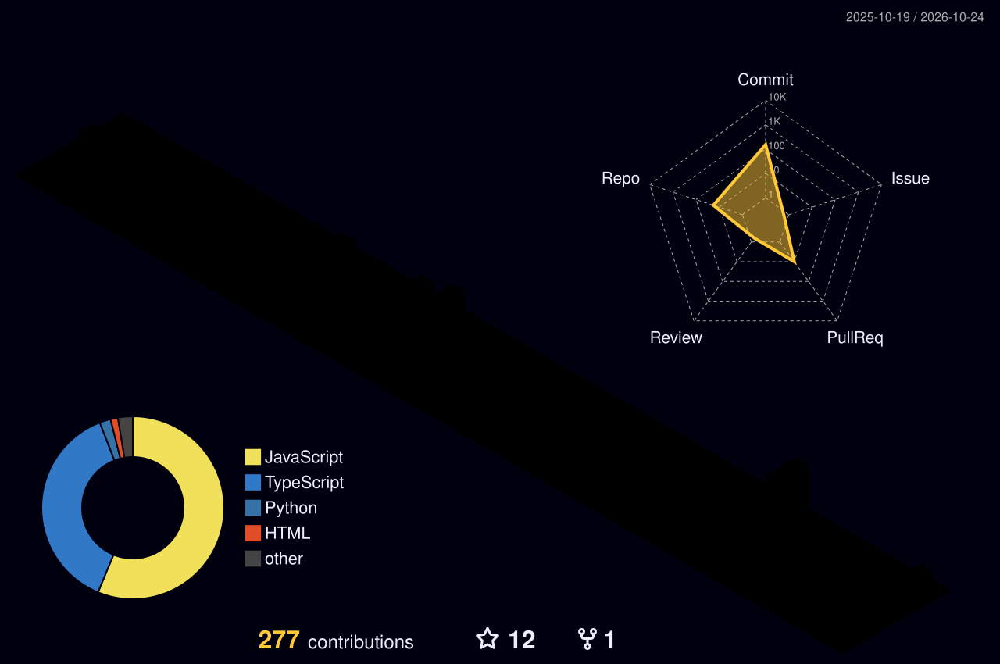

<p align="center">
  
</p>

<p align="center">
  <a href="https://github.com/samarthrao34">
    
  </a>
</p>

<p align="center">
  <a href="https://linkedin.com/in/samarthrao34"></a>
  <a href="https://x.com/otakusam3469"></a>
  <a href="https://instagram.com/samarthrao34"></a>
  <a href="https://pinterest.com/samarthrao34"></a>
  <a href="mailto:samarthrao34@gmail.com"></a>
  
</p>

<p align="center">
  <a href="#-whoami">whoami</a> ·
  <a href="#-tech-stack">stack</a> ·
  <a href="#-featured-builds">builds</a> ·
  <a href="#-3d-contribution-skyline">skyline</a> ·
  <a href="#-telemetry">telemetry</a>
</p>

## ⚡ whoami

```ts
const sam = {
  name:        "Samarth Rao",
  role:        "Engineering student @ Ashoka Institute of Technology & Management",
  focus:       ["AI / ML", "Emotionally intelligent assistants", "Full-stack web", "Linux systems"],
  learning:    "Deep learning, LLM agents & on-device inference",
  daily_drive: { os: "Arch Linux", wm: "Hyprland", editor: "Neovim / VS Code" },
  open_to:     ["Collaborations", "Micro-startup ideas", "Hackathons"],
  ask_me:      "anything AI",
  fun_fact:    "Built an AI that senses your mood — still can't pick a movie to watch.",
};
```

## 🛠 Tech stack

<table>
<tr>
<td width="50%" align="center" valign="top">
<h3>🧠 AI · ML · Data</h3>
<br/><br/>


</td>
<td width="50%" align="center" valign="top">
<h3>🌐 Frontend · Desktop</h3>

</td>
</tr>
<tr>
<td width="50%" align="center" valign="top">
<h3>⚙️ Backend · Databases</h3>
<br/><br/>

</td>
<td width="50%" align="center" valign="top">
<h3>☁️ Cloud · DevOps · Systems</h3>
<br/><br/>


</td>
</tr>
<tr>
<td colspan="2" align="center">
<h3>🎨 Design</h3>


</td>
</tr>
</table>

## 🚀 Featured builds

<table>
<tr>
<td width="50%" valign="top">

### [`yukti-main`](https://github.com/samarthrao34/yukti-main)
**Yukti Browser** — a personal, privacy-first Chromium fork based on Helium / ungoogled-chromium.

`C++` `Chromium` `Privacy`

</td>
<td width="50%" valign="top">

### [`Maya`](https://github.com/samarthrao34/Maya)
An emotionally intelligent AI companion that listens, remembers and responds with feeling.

`TypeScript` `LLMs` `Voice`

</td>
</tr>
<tr>
<td width="50%" valign="top">

### [`disha1`](https://github.com/samarthrao34/disha1)
**Project DISHA** — *"Guiding light in your emotional journey."* An empathetic AI companion.

`Python` `NLP` `AI`

</td>
<td width="50%" valign="top">

### [`glassos`](https://github.com/samarthrao34/glassos)
**GlassOS** — my own take on an operating-system desktop, running in the browser.

`TypeScript` `Web OS` `AI Studio`

</td>
</tr>
<tr>
<td width="50%" valign="top">

### [`NeuraEvoSim`](https://github.com/samarthrao34/NeuraEvoSim)
An experiment in neuroevolution simulation.

`TypeScript` `Neuroevolution` `Simulation`

</td>
<td width="50%" valign="top">

### [`akplay`](https://github.com/samarthrao34/akplay)
**AKPLAY** — streaming platform with a glassmorphism UI, AI chatbot, admin CMS and a Netflix-style intro.

`React` `TypeScript` `Vite`

</td>
</tr>
</table>

<p align="center"><a href="https://github.com/samarthrao34?tab=repositories"></a></p>

## 🏙 3D contribution skyline

<p align="center">
  <a href="https://github.com/samarthrao34?tab=overview">
    
  </a>
</p>

## 📡 Telemetry

<p align="center">
  
</p>

<p align="center">
  <picture>
    <source media="(prefers-color-scheme: dark)" srcset="assets/github-contribution-grid-snake-dark.svg" />
    <source media="(prefers-color-scheme: light)" srcset="assets/github-contribution-grid-snake.svg" />
    
  </picture>
</p>

---

<p align="center">
  <code>sam@github:~$ echo "thanks for stopping by — fork, star, or say hi 👾"</code>
</p>
